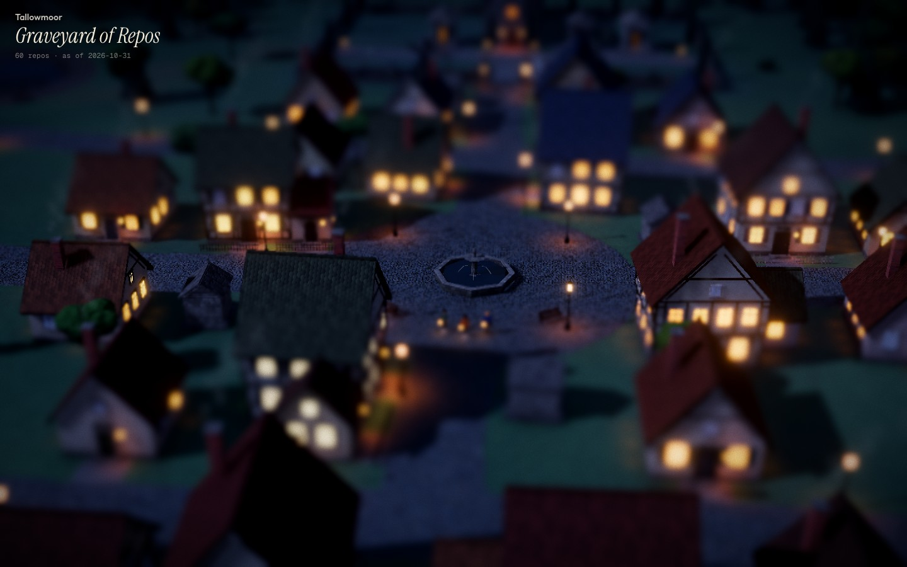
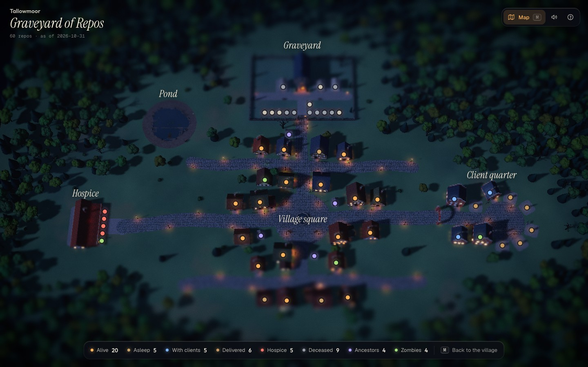
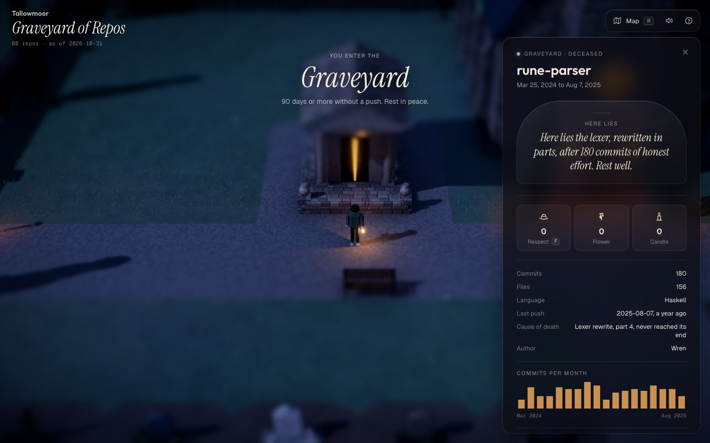

# graveyard

Every repository you ever started, as a house, a hospital bed or a grave in a small model village
at night. Walk through it and you see at a glance what is alive, what was built for clients and
what quietly died. Each grave carries an inscription written from the repo's own history.



## What lives where

| Place | Who ends up there |
| --- | --- |
| **House with smoke** | pushed within the last 30 days |
| **House with a light on** | no recent push, but its website still answers |
| **Client quarter** | client projects in progress; delivered ones become a **monument** |
| **Hospice** | 30 to 90 days without a push, with a countdown on the bed |
| **Graveyard** | more than 90 days without a push, or buried by hand |
| **Ancestral vault** | archived predecessors, resting beside the house of their successor |

A repo that came back after 90 days of silence keeps its place, but a zombie now walks around it.
Graves grow with the work that went into them: a wooden cross, a headstone, marble, a mausoleum.



Click a grave for its story: dates, commits, language, the last commit message as last words,
a cause of death and a comment from one of the mourners walking the lanes. Leave a flower or a
candle, or press F to pay respects.



## Try it

```sh
npm install
npm run dev          # http://127.0.0.1:8765
```

This opens Tallowmoor, an invented studio with 60 repos. Walk with WASD or by clicking, press M for
the map, Space or a click for details.

## Your own village

1. **Point it at your account.** In `graveyard.config.json`, set `owner` to your GitHub user or
   organisation. That is the only required setting.
2. **Collect the data.** `GITHUB_TOKEN=… npm run pipeline` reads your repos and writes
   `data/world.json`. A read-only token is enough; for private repos it needs read access to them.
   With `ANTHROPIC_API_KEY` set, Claude writes the inscriptions; without it every repo gets a plain
   one from facts.
3. **Put it online.** Deploy to Vercel (button below, or `npm run build` for any static host plus
   the functions in `api/`).

[](https://vercel.com/new/clone?repository-url=https%3A%2F%2Fgithub.com%2Fneuromanufaktur%2Fgraveyard&project-name=graveyard&repository-name=graveyard)

The button needs no settings: the demo runs as it is. Environment variables for sign-in, storage
and inscriptions are listed in [docs/deploy-button.md](docs/deploy-button.md).

### Keeping it fresh

- **Without storage:** the workflow `.github/workflows/update-world.yml` runs the pipeline once a
  day and commits `data/world.json` when something changed; Vercel deploys the new version.
- **With storage** (Upstash Redis): the village refreshes itself when someone opens it, at most once
  every 24 hours, and visitors see each other walk around.

Inscriptions are only rewritten for repos with new commits, so the bill for Claude stays at cents.

## Telling the village what is what

The pipeline sorts repos with GitHub topics, so new repos are placed by setting a topic on GitHub:

| Topic | Meaning |
| --- | --- |
| `graveyard-product`, `graveyard-client`, `graveyard-experiment`, `graveyard-internal` | category (default: experiment) |
| `graveyard-client-<slug>` | client project for `<slug>`; the display name comes from `clients` in the config |
| `graveyard-buried` | rests in the graveyard even though it is still pushed or online |
| `graveyard-successor-<repo>` | archived predecessor of `<repo>`, goes into its vault |

The homepage field of a repo is used for the "light still on" check. Archived repos count as
buried. For repos you cannot tag (archived ones are read-only), a classification file does the
same job: `npm run pipeline -- --classification classification.json`, format in [DATA.md](DATA.md).

## Configuration

Everything beyond `owner` is optional; `config.schema.json` describes each field, and the demo's
`graveyard.config.json` shows them in use.

- `team`: playable characters, drawn from a few choices (hair, beard, clothes, a prop) and an
  optional photo for the name tag.
- `mourners`: characters who walk the lanes and comment on graves, each with a short role that
  goes into the prompt.
- `clients`: display names for client slugs.
- `exclude`: repos that never appear anywhere.
- `thresholds`: days until hospice and graveyard, commit counts for the grave tiers.
- `language`: interface and inscriptions in English (`en`) or German (`de`); `epitaphs.tone` and
  `epitaphs.project` shape the voice of the inscriptions.
- `auth`, `storage`: see below.

## Building blocks

| | Off | On |
| --- | --- | --- |
| Sign-in | anyone with the link can walk in | Auth.js provider (`github`, `google`, `gitlab`, `microsoft-entra-id`) and allowed e-mail domains |
| Storage | the village is read from `data/` | Upstash Redis: multiplayer, shared flowers and candles, refresh on open |
| Inscriptions | plain text from facts | Claude via `ANTHROPIC_API_KEY`, only for new commits |

## Private repositories

`data/world.json` holds repo names, descriptions, commit counts, author names and last commit
messages. If any of your repos are private, turn on sign-in before you put the village online.
With `ANTHROPIC_API_KEY` set, the pipeline sends each repo's description, commit history, file
overview and README excerpt to Anthropic to write the inscription.

## Under the hood

three.js with postprocessing and N8AO, built with Vite. Every house, grave and figure is modelled
in code; there are no asset packs. The sound (crickets, wind, footsteps, the odd owl) is generated
in the browser and starts only after the first click. The data format is described in
[DATA.md](DATA.md); contributions are welcome, see [CONTRIBUTING.md](CONTRIBUTING.md).

## License

MIT, see [LICENSE](LICENSE).

Made by [neuromanufaktur](https://neuromanufaktur.ai).
